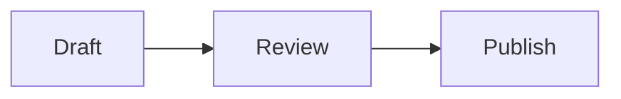

# Markdown 문서 컴포넌트

글 본문과 관리자 미리보기는 아래 fenced code block을 문서 컴포넌트로 렌더링한다. fence가 비어 있거나 형식 검증에 실패하면 일반 코드블럭으로 표시되므로 원문은 사라지지 않는다.

## Mermaid

언어 라벨을 `mermaid`로 지정하고 Mermaid 문법을 그대로 적는다.

````markdown

````

브라우저에서 다이어그램 변환에 실패하면 원문 코드블럭을 대신 표시한다. Mermaid 원문은 HTML로 실행하지 않는다.

## 설치 안내

언어 라벨이 `installer`인 fence 안에 JSON 객체를 적는다.

````markdown
```installer
{
  "title": "Raven SDK 설치",
  "intro": "사용 중인 패키지 매니저를 선택하세요.",
  "managers": {
    "pnpm": "pnpm add @raven/sdk",
    "npm": "npm install @raven/sdk",
    "yarn": "yarn add @raven/sdk",
    "bun": "bun add @raven/sdk"
  },
  "steps": [
    {
      "title": "환경 변수 추가",
      "description": "서버 환경에 API 키를 등록합니다.",
      "language": "bash",
      "code": "export RAVEN_API_KEY=your-key",
      "note": "키를 저장소에 커밋하지 마세요."
    },
    {
      "title": "클라이언트 생성",
      "language": "ts",
      "code": "const raven = createClient()",
      "tip": "클라이언트는 한 번만 생성해 재사용하세요."
    }
  ]
}
```
````

- `title`: 필수 문자열
- `intro`: 선택 문자열
- `managers`: `agents` 대신 사용할 수 있는 선택 객체. `npm`, `pnpm`, `yarn`, `bun` 중 하나 이상의 명령 문자열이 필요하다. JSON에 먼저 적은 유효한 항목이 기본 탭이 된다.
- `agents`: `managers` 대신 사용할 수 있는 선택 객체. `codex`, `claude-code`, `grok` 중 하나 이상의 명령 문자열이 필요하며 화면에는 각각 `Codex`, `Claude Code`, `Grok` 탭으로 표시된다. JSON에 먼저 적은 유효한 항목이 기본 탭이 된다.
- `steps`: 하나 이상의 객체가 필요한 배열
- 각 단계의 `title`: 필수 문자열
- 각 단계의 `description`, `language`, `code`, `note`, `tip`: 선택 문자열

패키지 매니저가 아닌 에이전트별 명령을 보여주려면 `managers`를 생략하고 `agents`를 적는다.

````markdown
```installer
{
  "title": "에이전트 설치",
  "agents": {
    "codex": "raven install --agent codex",
    "claude-code": "raven install --agent claude-code",
    "grok": "raven install --agent grok"
  },
  "steps": [
    { "title": "설치 확인", "code": "raven doctor" }
  ]
}
```
````

`managers`와 `agents`를 함께 적으면 기존 문법과의 호환을 위해 `managers`만 화면에 표시한다. 두 객체의 키는 각각 허용된 이름만 사용할 수 있고 명령 문자열은 비어 있을 수 없다.

탭 명령 문자열에서 명령 사이에 독립적으로 놓인 compact continuation 표기(`\\ --flag`)는 화면과 복사 결과에서 backslash를 남긴 채 다음 줄로 펼쳐진다. compact 표기에는 두 칸 들여쓰기를 넣고, 이미 backslash 다음에 줄바꿈이 있는 값은 작성한 들여쓰기를 그대로 보존한다. 경로 등에 들어 있는 임의의 backslash와 설치 단계의 `code` 값은 변환하지 않는다. 그 밖의 앞뒤 공백도 포함해 코드블럭에 표시되며, 공백만 있는 값은 유효한 명령이나 코드로 보지 않는다.

알 수 없는 필드, 허용하지 않은 패키지 매니저, 잘못된 JSON은 설치 안내로 변환하지 않는다. 관리자 텍스트 편집에서 다른 내용을 수정해도 두 컴포넌트는 각 fence 원문으로 돌아간다.

## HTML 임베드

직접 만든 HTML 페이지(인터랙티브 데모, 일러스트가 많은 설명 화면 등)를 본문에 끼운다. 관리자 에디터 툴바의 HTML 임베드 버튼으로 `.html` 파일을 올리면 아래 fence가 커서 위치에 들어간다.

````markdown
```embed
{"src":"/assets/embeds/2026-10-06/123e4567-e89b-12d3-a456-426614174000.html","title":"프리셋 갤러리","height":640}
```
````

- `src`: 필수. 관리자 업로드가 만든 `/assets/embeds/<날짜>/<이름>.html` 경로만 받는다. 외부 URL이나 이미지 경로는 받지 않는다.
- `title`: 필수 문자열(120자 이하). iframe의 접근성 이름이 된다.
- `height`: 선택 정수(120~4000, 기본 480). 문서가 높이를 알려 오기 전까지 쓰는 값이다.

iframe은 `sandbox="allow-scripts"`로만 열린다. 문서 안의 스크립트는 돌지만 불투명 origin이라 사이트와 CDN의 쿠키·저장소에 닿지 않고, 팝업·폼 제출·상위 창 이동도 막힌다. 개발 CDN(`docker/cdn-dev/nginx.conf`)은 `/assets/embeds/`에 `Content-Security-Policy: sandbox allow-scripts`를 붙여, 주소를 직접 열어도 같은 격리가 걸린다.

### 높이 자동 맞춤

문서가 자기 높이를 알려 주면 본문이 iframe 높이를 맞춘다(120~6000px로 자른다). 메시지는 본문의 임베드 iframe이 보낸 것만 받는다. 문서 끝에 다음 스크립트를 넣는다.

```html
<script>
  const report = () =>
    parent.postMessage(
      { type: 'raven:embed-height', height: document.body.getBoundingClientRect().height },
      '*',
    );
  new ResizeObserver(report).observe(document.body);
  report();
</script>
```

`document.documentElement.scrollHeight`를 쓰면 안 된다. 이 값은 iframe 높이보다 작아지지 않아서 iframe이 커지기만 하고 줄어들지 못한다. `body`에 세로 여백(margin)이 있으면 그만큼 잘리므로 `body { margin: 0 }`으로 둔다.

반대로 높이를 `100vh`·`100dvh`로 잡는 문서(화면을 꽉 채우는 갤러리 등)는 높이를 보내지 않는다. 보낸 높이로 iframe이 커지면 vh도 같이 커져서 끝없이 늘어난다. 이런 문서는 fence의 `height`로 크기를 정한다.

스크립트가 없으면 fence의 `height`가 그대로 쓰인다. 내용보다 짧으면 iframe 안에서 스크롤된다.

### 만들 때 주의

- 글 검색과 목차는 iframe 안을 보지 못한다. 설명하는 글은 마크다운 본문에 두고, 마크다운으로 옮길 수 없는 그림·인터랙션만 임베드로 넣는다.
- 업로드는 앞 1024바이트의 UTF-8과 문서 시작을 검사한다. 첫 글자(BOM·공백 제외)가 `<!doctype html` 또는 `<html`이어야 하며, 앞에 주석이 있거나 조각 HTML이면 415로 거절된다. 전체 문서 인코딩·내용을 검사하는 기능은 아니다.
- 업로드 한도는 10MB다. 웹폰트를 base64로 통째로 넣으면 금방 커지니 쓰는 글자만 남긴 서브셋을 넣는다.
- 관리자 텍스트 편집에서 다른 내용을 고쳐도 임베드는 fence 원문으로 돌아간다.

### CDN 반영

dev 앱 배포는 web 컨테이너만 갱신한다. 저장소의 `docker/cdn-dev/nginx.conf`를 호스트의 `/srv/docker/raven-cdn-dev/nginx.conf`에 동기화한 뒤 `deploy/server/deploy-cdn-dev.sh`로 CDN 컨테이너를 재생성해야 새 location과 CSP가 적용된다. `deploy-dev.yml`의 수동 실행에서 `refresh_cdn=true`를 선택하면 재생성은 실행하지만, 호스트 설정 파일을 복사하지는 않는다.

운영 R2 업로드는 `Content-Type: text/html`을 저장하지만 CSP를 자동으로 붙이지 않는다. 운영 공개 전에 다음을 적용하고 실제 응답을 확인한다.

- `cdn.raven.kr`의 `/assets/embeds/`에 이미지 변환·rewrite를 우회하고 `Content-Security-Policy: sandbox allow-scripts`를 설정한다. [Cloudflare 응답 헤더 변환 규칙](https://developers.cloudflare.com/rules/transform/response-header-modification/)을 사용할 수 있다.
- `Content-Type: text/html`, CSP, `X-Content-Type-Options: nosniff`를 직접 URL에서도 확인한다. [R2 HTTP metadata](https://developers.cloudflare.com/r2/api/workers/workers-api-reference/#http-metadata)에는 CSP 필드가 없으므로 응답 경로에서 별도로 설정한다.
- `r2.dev`와 다른 custom domain이 열려 있으면 동일한 헤더를 확인하거나 우회 공개를 끈다. [R2 공개 버킷](https://developers.cloudflare.com/r2/buckets/public-buckets/)의 custom domain 경로를 확인한다.
- 업로드는 새 UUID 경로를 권장한다. 같은 키를 덮어쓸 때는 CDN 캐시를 삭제해도 이미 받은 브라우저의 1년 `immutable` 캐시는 남을 수 있다.
